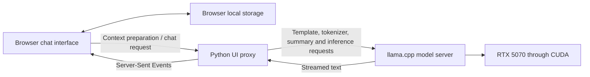

# Local TwIL Deployment on a 12 GB GPU

## Technical report for mentor review

**Project owner / presenter:** Jester Moon

**Date:** 9 November 2026

**Repository:** [jestermoon01/-TwIL-8B-Abliterated-Uncensored](https://github.com/jestermoon01/-TwIL-8B-Abliterated-Uncensored)

**Implementation reviewed:** `ab5f5786bb0ddb3ed662ae85fce6338e529e2d52`

## 1. Project objective and outcome

The objective was to run `Guilherme34/TwIL-8B-Abliterated-Uncensored` on a Windows
PC with an NVIDIA RTX 5070 and approximately 12 GB of VRAM, then provide a usable
local chat interface. The main engineering problems were fitting the weights and
inference buffers into GPU memory, managing a finite context window, recovering
answers interrupted by output limits, and making cancellation predictable.

The resulting system provides:

- GPU inference through llama.cpp with an authenticated OpenAI-compatible API.
- An HTML/CSS/JavaScript chat interface with streamed Markdown rendering.
- Saved conversations with switching, renaming, deletion and JSON export.
- Automatic summarization of older conversation content.
- Automatic continuation of answers that hit an output-token limit.
- Stop and manual Continue controls that retain partial answers.
- A Docker Compose deployment for both inference and the interface.

This work concerns deployment and inference engineering. It uses an existing
quantized model artifact; it does not claim to have trained the model or produced
the quantization. The word “uncensored” is part of the model publisher's name,
not a guarantee about how the model will answer every prompt.

## 2. System architecture



The Python proxy inserts the model API key on the server side. The browser does
not need the key in its HTML or JavaScript. Context preparation happens before
generation; the same local model performs summarization when it is needed.

The current deployment runs two long-lived containers:

| Service | Responsibility | Host endpoint |
| --- | --- | --- |
| Model | CUDA inference, tokenization and chat-template application | `http://127.0.0.1:8080/v1` |
| UI | HTML assets, validation, context preparation and streaming proxy | `http://127.0.0.1:8081` |

Both published ports bind to loopback, making the deployment local to this PC.
Services listen on their container interfaces internally so they can communicate
over the Compose network. This does not publish the ports on the PC's LAN address.

An optional, short-lived download container retrieves and verifies the model.
The running model mounts its weights read-only rather than embedding several
gigabytes of weights in an application image.

## 3. How the model fits in VRAM

### 3.1 Why the original weights are too large

The inspected model metadata reports approximately **8.79 billion parameters**.
At two bytes per parameter, FP16 weights alone would require approximately:

```text
8.79 billion parameters × 2 bytes ≈ 17.6 GB ≈ 16.4 GiB
```

That exceeds the GPU's capacity before allocating the attention cache, compute
buffers or other CUDA resources. Loading FP16 weights entirely on this GPU was
therefore unsuitable.

### 3.2 Quantization reduces weight storage

The selected artifact is a **Q5_K_M GGUF** from
`mradermacher/TwIL-8B-Abliterated-Uncensored-GGUF`. Quantization represents many
weights with fewer bits, together with the scales and metadata needed to use
them during inference. Q5_K_M uses mixed tensor precision; the entire model is
not uniformly stored at exactly five bits per parameter.

The downloaded artifact is **6,253,887,808 bytes**, approximately **6.25 GB** or
**5.82 GiB** on disk. Disk size and GPU allocation are different measurements:
some tensors and metadata remain CPU-mapped, and CUDA has additional allocations.

Quantization trades numerical precision for lower memory use. It does not reduce
the model's parameter count, and this project has not measured the quality loss
against the original FP16 checkpoint.

### 3.3 Memory must cover more than weights

A useful inference memory model is:

```text
GPU usage ≈ resident model weights + KV cache + compute buffers + other allocations
```

The observed Docker deployment reported the following allocations:

| Measurement | Observed value | Interpretation |
| --- | ---: | --- |
| GPU model buffer | 5,691.27 MiB | Quantized weights resident on CUDA |
| GPU KV cache | 1,280.00 MiB | Cached attention keys and values |
| GPU compute buffer | 103.01 MiB | Working space for computation |
| Total GPU usage sampled with NVIDIA tooling | 7,426 MiB | About 7.25 GiB across the GPU |
| Reported GPU capacity | 12,227 MiB | About 11.94 GiB |

The difference between the three named buffers and total GPU usage is about
352 MiB. It includes other allocations and GPU users; it is a derived remainder,
not a separately measured model buffer. At the sampled usage, approximately
4,801 MiB, or 4.69 GiB, remained available. This is observed headroom, not a
guarantee for every workload.

The startup log confirms **41/41 offloadable layers on the GPU**. The source
configuration has 40 transformer layers; the offload count also includes the
output layer. Small CPU-mapped portions and host buffers remain, so this does
not mean every byte associated with the model resides in VRAM.

### 3.4 Why context size matters to memory

The KV cache stores attention keys and values for previous tokens so generation
can reuse them. Its size grows with allocated context capacity and cache precision.
For this model's configuration, an approximate FP16 KV calculation is:

```text
40 layers × 8 KV heads × 128 dimensions × 2 (K and V) × 2 bytes
    = 163,840 bytes per token
    = 160 KiB per token

8,192 allocated token positions × 160 KiB = 1,280 MiB
```

This matches the reported cache allocation. The deployment uses an 8,192-token
total context divided between two slots, approximately 4,096 tokens per slot.
Keeping context and concurrency modest is part of the memory strategy.

Flash attention is enabled. It can improve attention execution and memory
behavior, but this project's measurements do not isolate its benefit. The
observed VRAM fit is primarily explained by quantized weights and the bounded
context/cache configuration. KV-cache quantization was not required for this run.

## 4. Managing the context window

### 4.1 Input and output share a finite budget

The context window must contain the rendered prompt, relevant conversation
history, any summary, and the output being generated. A conversation cannot grow
indefinitely inside that window, even if its full transcript remains saved.

Before each generation segment, the application computes:

```text
slot context = total context / parallel slots
input budget = slot context - requested output tokens - safety margin
```

With the default browser settings:

```text
slot context = 8,192 / 2 = 4,096 tokens
output reservation = 512 tokens
safety margin = 128 tokens
input budget = 4,096 - 512 - 128 = 3,456 tokens
```

Increasing the output reservation leaves less room for the input. For example,
reserving 2,048 output tokens leaves a 1,920-token input budget with these settings.

### 4.2 Count actual model tokens

Character count is an unreliable substitute for token count, especially for
code, punctuation and different languages. The context manager calls the running
engine's `/apply-template` endpoint to obtain the actual generation prompt, then
uses `/tokenize` to count it. Continuation text is included in this accounting.

The chat template comes from the GGUF metadata. The inspected source tokenizer
configuration had no chat template, so the project did not invent a prompt format.
The embedded GGUF template was inspected and verified before serving.

### 4.3 Summarize before the window fills

Compaction is triggered when the input exceeds 80% of its available budget, or
when the active context reaches 38 messages. The latter keeps requests below the
40-message validation limit even when individual messages are short.

The process is:

1. Select older turns for summarization, initially aiming to retain recent turns
   around a four-message target and preserve complete user/assistant boundaries.
2. Ask the local model to merge the previous summary with those older turns.
3. Preserve goals, names, constraints, decisions, identifiers and unresolved work
   in a concise memory, using a default 384-token summary output limit.
4. Recount the prepared prompt. Compact more older material if it still exceeds
   the input budget, while retaining the newest user turn.
5. Reject a request that still cannot fit, rather than silently discarding its
   newest message.

Summarization requests also have context limits. Older material is split into
bounded text pieces and grouped into batches that are checked against the
summarizer's own token budget.

The interface displays the resulting memory in an expandable notice. The
**complete original transcript remains visible and saved**; only the context
sent to the model is compressed. Saved chats use browser local storage and can
be exported. Clearing that storage or changing browser profiles can remove access
to those saved chats, so export provides a portable backup.

In the recorded live summarization test, the prepared context used **1,056 of
3,456 available input tokens**, retaining three recent turns and the project's
key fact in the summary. This validates that example, not perfect recall for all
conversations: summarization is lossy and can omit or distort details.

## 5. Recovering answers that are cut off

### 5.1 Distinguish output limits from other failures

An answer can stop for several reasons:

| Signal | Meaning | Application behavior |
| --- | --- | --- |
| `finish_reason=stop` | The engine reports a normal stop | Save the answer as finished |
| `finish_reason=length` | The output-token limit was reached | Continue automatically when enabled |
| Stream ends without a finish reason | Completion was not confirmed | Preserve partial text and offer Continue |
| User presses Stop | Cancellation was requested | Stop follow-up requests and retain partial text |

The model logs showed requests producing exactly 512 output tokens. That
identified a concrete output-budget cut, rather than evidence of a VRAM failure.

### 5.2 Continue the same answer

Simply increasing the token limit would still leave a finite limit and reduce
the available input budget. Instead, the interface generates additional segments
when the engine reports `length`.

For continuation, the proxy obtains the rendered model chat prompt, appends the
unfinished assistant text, and uses `/v1/completions` to predict what follows.
The browser appends those tokens to the existing assistant reply. It does not
insert a visible new user message or ask the model to restart its answer.

This matters for exact joins: a continuation can resume after a comma or inside
a code block while the interface retains the original text and formatting.
Both chat-style streamed deltas and completion-style streamed text are supported.

### 5.3 Keep continuation inside the context budget

Every segment is prepared and counted again. If a growing answer no longer fits,
the older part of that answer can be summarized alongside earlier context while
its exact ending remains as the continuation prefix. The initial retained tail
target is 1,536 characters and can shrink to 128 characters if necessary to fit.
These are tail-selection bounds, not token estimates; the resulting prompt is
still checked with the actual tokenizer.

Only the model's working context is compressed. The displayed and saved answer
keeps all previously generated text. Very long code or reasoning can nevertheless
lose important earlier details after summarization; exact-tail continuation does
not guarantee global semantic consistency.

### 5.4 Bound automatic work

Auto-finish allows at most **four continuations after the initial segment** per
attempt. With a 512-token segment limit, that allows up to approximately 2,560
answer tokens across five segments before pausing. Summary generation is separate
from this answer budget.

At the cap, **Continue response** resumes the saved partial answer manually.
Users can also disable auto-finish and use that button directly. Completion
metadata is saved with the answer, making manual continuation available after a
page reload. The cap prevents a poorly terminating model from generating forever.

The mechanism repairs token-limit interruptions. A normal engine stop does not
prove that the answer is correct, sufficiently detailed or semantically complete.

## 6. Stop and cancellation behavior

Each generation attempt uses a browser `AbortController`. Pressing Stop aborts
the active browser request, including context preparation or a continuation
request, and prevents the interface from starting further automatic segments.

The UI proxy streams data through an HTTP client. When browser disconnection is
detected during streaming, the proxy exits the response/client context and closes
the upstream connection. The interface retains the text already received, marks
the attempt as cancelled or interrupted, and offers Continue where appropriate.

Stop acts on that answer generation; it does not shut down the model container.
GPU cancellation propagation depends on connection handling and engine scheduling,
so this project does not claim zero-latency cancellation. The browser regression
test verifies that Stop cancels a pending continuation and starts no more retries.

## 7. Deployment, reproducibility and local access

The final Compose setup uses the official llama.cpp CUDA 13 image at **b10015**.
The native Windows validation previously used a CUDA 13.3 b10000 build. An outdated
Windows C++ runtime initially prevented native startup; updating that runtime
resolved the native verification issue. The final Linux containers use their own
user-space runtime rather than the Windows C++ DLLs.

Reproducibility is supported by:

- A pinned GGUF repository revision and verified SHA-256 checksum.
- Digest-pinned model, Python and uv container images.
- A committed Python dependency lockfile.
- Typed settings and recorded runtime flags.
- Model weights, local credentials, environments and logs excluded from Git.
- An unprivileged long-running UI container, health checks, restart policies and
  rotated Docker logs.

The API requires a key, while the proxy supplies it automatically for local chat.
Browser requests are validated, and unexpected Host headers and foreign origins
are rejected. Markdown is rendered with locally bundled markdown-it and DOMPurify;
raw HTML is disabled and rendered HTML is sanitized. This is a local desktop
deployment, not a multi-user access-control system.

## 8. Validation and measured results

| Check | Recorded result |
| --- | --- |
| Docker model and UI health | Both healthy |
| GPU offload | 41/41 offloadable layers |
| Missing API key | Rejected with HTTP 401 |
| Normal and streaming responses | Passed |
| Twelve sequential requests | Passed; total GPU usage sampled at 7,426 MiB throughout |
| Longer generation timing | Approximately 90.11 generated tokens/second over 128 tokens |
| Conversation management | Save/reload, switch, rename, delete and export passed |
| Live context compaction | Preserved the test fact; prepared context fit its budget |
| Live output-limit recovery | Numbers 1–80 completed in order after a 128-token limit, with no duplicate prefix |
| Live code continuation | Six-method Python class completed after two continuations in one code block |
| Generated code verification | Python syntax parsed successfully; generated code was not executed |
| Python tests | 21 passed |
| Optional browser smoke tests | 5 passed |
| Lint, formatting and typing | Ruff and strict mypy passed |

The optional browser checks cover automatic continuation, the retry cap, manual
continuation after reload, interrupted streams and Stop. They mock inference to
make those control-flow tests repeatable; the separate live tests above used the
actual deployed model.

The throughput and memory observations are short local measurements. They do
not establish long-duration thermal stability, peak memory for every workload,
multi-user service capacity or formal model accuracy. No FP16-versus-Q5 quality
comparison was performed. The arithmetic and instruction-following examples are
smoke tests, not a comprehensive benchmark.

## 9. Reproduction commands

From the repository directory, with Docker Desktop running and a valid local
`.env` containing the API key:

```powershell
# Optional first-time model acquisition; verifies the pinned SHA-256.
docker compose build ui
docker compose --profile tools run --rm download

# Start the model and interface, then inspect health and logs.
docker compose up --build --detach --wait
docker compose ps
docker compose logs --tail 30 model

# Open http://127.0.0.1:8081 to use the interface.

# Run the Python quality gate with the project's uv environment.
uv run ruff check .
uv run ruff format --check .
uv run mypy src
uv run pytest

# Optional browser control-flow tests with an installed Chromium browser.
$env:TWIL_BROWSER_EXECUTABLE = 'C:/Program Files/BraveSoftware/Brave-Browser/Application/brave.exe'
uv run --with playwright==1.64.1 pytest -m smoke tests/test_browser_finish.py

# Stop the deployment without deleting browser-saved conversations.
docker compose down
```

For a fresh checkout, follow the README's credential setup instructions first.
The download service needs network access to acquire weights; inference runs
locally once the required artifacts are available. Do not share the local `.env`
with the report.

## 10. Evidence and implementation references

The following paths are relative to the repository, making this report portable
when shared with the project:

| Reference | What it supports |
| --- | --- |
| [README.md](README.md) | Setup, manifests and operating instructions |
| [compose.yaml](compose.yaml) and [Dockerfile](Dockerfile) | Container topology, GPU access, pinned images and local port bindings |
| [config.py](src/twil_deploy/config.py) | Typed defaults and environment settings |
| [context.py](src/twil_deploy/context.py) | Template/token counting, budgets, summaries and continuation-tail handling |
| [ui.py](src/twil_deploy/ui.py) | Authenticated proxy and continuation endpoint selection |
| [chat.js](src/twil_deploy/static/chat.js) | Saved conversations, continuation loop, Stop and partial-answer recovery |
| [acceptance.json](reports/acceptance.json) | Sequential-request, memory and generation-timing observations |
| [conversations.json](reports/conversations.json) | Recorded live summarization example |
| [finish-acceptance.json](reports/finish-acceptance.json) | Live continuation checks and control-flow checks |
| [tests/](tests/) | Unit, integration and optional browser regressions |

The GGUF artifact revision is
`185406da788423cc0d0dc13f290fea87072904b2`, and its verified SHA-256 is
`fbec9bf51afe4419abd7c62fceac9126b557a1ae56af884b0c19b9264c13e08c`.
The model image digest and base-image digests are recorded in Compose and the
Dockerfile. Hash verification establishes artifact integrity; it does not
independently establish the fine-tune's quality or the exact source revision
used by the third-party quantizer.
